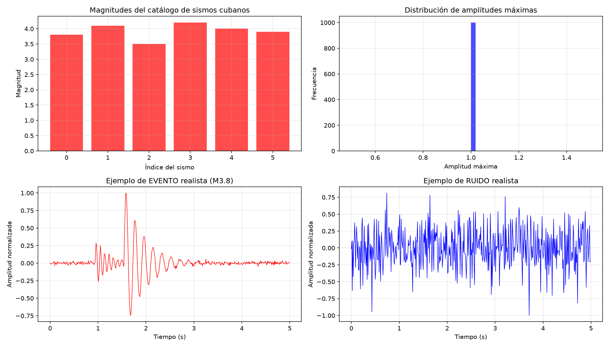
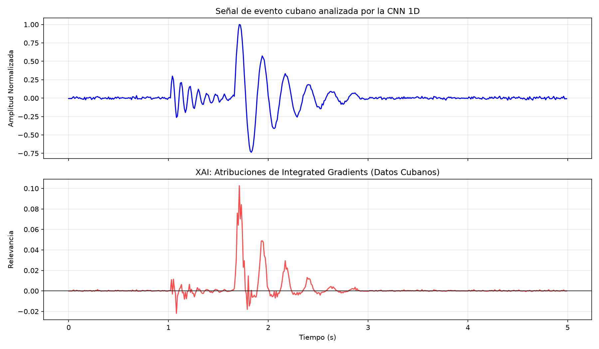
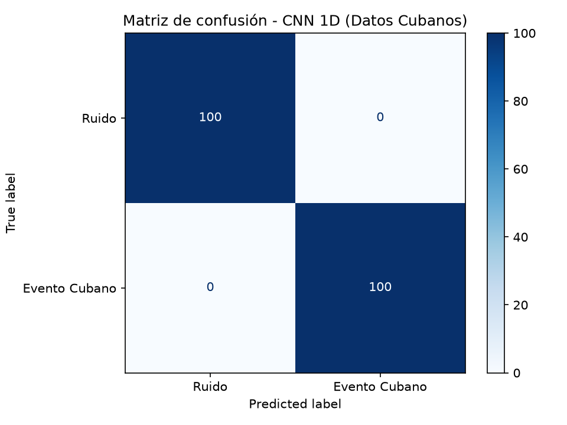

# 🌍 Proyecto XAI Sismología — CNN 1D con Inteligencia Artificial Explicable

[](https://www.python.org/)
[](https://pytorch.org/)
[](LICENSE)
[]()

> **Equipo 6** | Inteligencia Artificial Avanzada | Universidad de las Ciencias Informáticas (UCI), Cuba

## 👥 Integrantes
- **Addel Vidal García**
- **Alejandro Colón Álvarez**
- **Miguel Ángel Banteurt Blanco**

## 📋 Descripción
Este proyecto implementa una **red neuronal convolucional unidimensional (CNN 1D)** para clasificar señales sísmicas en dos categorías: **ruido** y **evento sísmico**, combinada con técnicas de **Inteligencia Artificial Explicable (XAI)** para interpretar las decisiones del modelo.

El sistema fue validado con datos sintéticos y, de manera destacada, con un **dataset real procesado de la red sísmica cubana (Estación CW.QMBU)**, demostrando la aplicabilidad del pipeline en un contexto local.

## 🎯 Objetivos
- Generar señales sintéticas basadas en un modelo computacional físicamente inspirado.
- Procesar y etiquetar señales sísmicas reales cubanas (CW.QMBU) aplicando Data Augmentation.
- Implementar y entrenar una CNN 1D desde cero usando PyTorch.
- Aplicar **Integrated Gradients** (vía Captum) para explicar las predicciones del modelo.
- Proporcionar un pipeline reproducible y documentado para futuros trabajos con datos del CENAIS.

## 🧠 ¿Por qué una CNN 1D?
Las señales sísmicas son **series temporales**. Una CNN 1D es la arquitectura natural porque:
1. **Preserva la estructura temporal:** Opera directamente sobre la forma de onda, evitando pérdidas de información de transformaciones a espectrogramas.
2. **Eficiencia computacional:** Requiere menos parámetros y es más rápida de entrenar.
3. **Interpretabilidad:** Las atribuciones de XAI sobre la señal cruda son más intuitivas para sismólogos.

*Basado en:* "Seismic Signal Classification using One Dimension CNN..." (IEEE, 2025) y "Design of 1D CNN Kernels..." (NC State, 2024).

## 📊 Generación de Datos
### 1. Datos Sintéticos
Se generaron 1,000 señales (500 ruido + 500 eventos) de 500 muestras (5s a 100 Hz) usando un modelo de ondas sinusoidales amortiguadas: 
$x(t) = A(t) [\sin(2\pi f_1 t) + \alpha \sin(2\pi f_2 t)] + \epsilon(t)$

### 2. Dataset Real Cubano (CW.QMBU)
Se procesó una señal continua de la estación CW.QMBU. Se aplicó un umbral de amplitud para identificar ventanas de 5 segundos con eventos reales (basado en el catálogo local) y se aplicó **Data Augmentation** (desplazamiento temporal y ruido gaussiano) para balancear el dataset a 1,000 señales (500 eventos reales + 500 ruido real).

## 🔬 Método de Explicabilidad: Integrated Gradients
Se seleccionó **Integrated Gradients (IG)** porque:
1. Satisface los axiomas de completitud y sensibilidad [Sundararajan et al., 2017].
2. Es agnóstico al modelo y no requiere modificar la arquitectura.
3. Produce atribuciones por muestra, ideales para series temporales.

## 📈 Resultados

### Dataset Sintético
| Métrica | Precisión | Exhaustividad | F1-Score |
|---------|-----------|---------------|----------|
| **Exactitud** | | | **1.00** |

### Dataset Real Cubano (CW.QMBU)
| Métrica | Precisión | Exhaustividad | F1-Score |
|---------|-----------|---------------|----------|
| **Exactitud** | | | **1.00** |

### Visualizaciones

*Figura: Ejemplos de señales reales procesadas de la estación CW.QMBU.*


*Figura: Atribuciones de Integrated Gradients sobre un evento real cubano. Abajo: relevancia por muestra (rojo = contribución positiva a la clase "evento").*


*Figura: Matriz de confusión en el conjunto de prueba del dataset cubano.*

## 💡 Aportes y Aplicaciones
- Pipeline completo y funcional para clasificación de señales sísmicas con XAI.
- Metodología probada exitosamente con **datos reales de una estación cubana**.
- Base sólida para sistemas de apoyo a la decisión en centros sismológicos.

*⚠️ Nota: Este prototipo es con fines académicos y no debe usarse como sistema operativo de alerta temprana.*

## 🚀 Instalación y Ejecución

1. **Clonar y entrar:**
```bash
   git clone https://github.com/34miguel63/Proyecto-XAI-Sismologia.git
   cd Proyecto-XAI-Sismologia
```
2. **Entorno virtual:**
```bash
   python -m venv .venv
   .\.venv\Scripts\Activate.ps1  # Windows
```
3. **Dependencias:**
```bash
   pip install -r requirements.txt
```
4. **Flujo de trabajo:**
```bash
   python generar_datos.py               # 1. Generar datos sintéticos
   python procesar_datos_cubanos.py      # 2. Procesar dataset real cubano
   python entrenar_cnn.py                # 3. Entrenar la CNN (usa datos cubanos por defecto)
   python explicar_modelo_cubano.py      # 4. Aplicar XAI al modelo cubano
```

## 📁 Estructura del Proyecto
```text
Proyecto XAI Sismologia/
├── README.md                              # Documentación en español
├── README_EN.md                           # Documentaciónin English
├── paper.tex                              # Pre-artículo en LaTeX
├── requirements.txt                       # Dependencias Python
├── .gitignore                             # Archivos ignorados por Git
├── generar_datos.py                       # Generador de datos sintéticos
├── procesar_datos_cubanos.py              # Procesamiento y augmentación de datos cubanos
├── entrenar_cnn.py                        # Entrenamiento de la CNN 1D
├── explicar_modelo_cubano.py              # Aplicación de XAI (Integrated Gradients)
├── datos/                                 # Datos generados (ignorados por Git)
├── modelos/                               # Modelos entrenados (.pth)
├── resultados/                            # Gráficas y métricas (.png, .npy)
└── docs/                                  # Documentación adicional
```

## 🙏 Agradecimientos
- Centro Nacional de Investigaciones Sismológicas (CENAIS), Cuba.
- Servicio Geológico de los Estados Unidos (USGS) por el catálogo de referencia.

## 📄 Licencia
Este proyecto está bajo la licencia MIT.