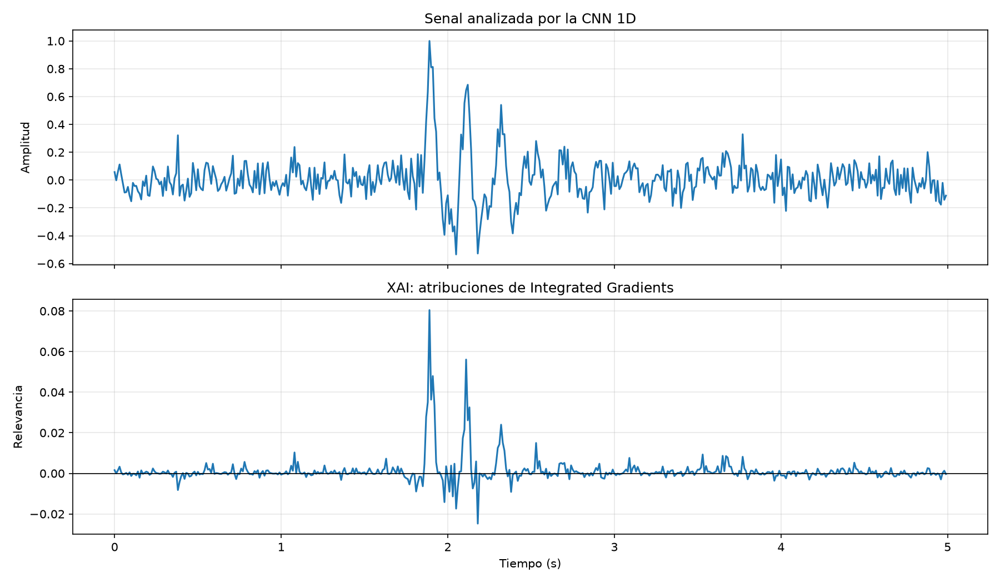
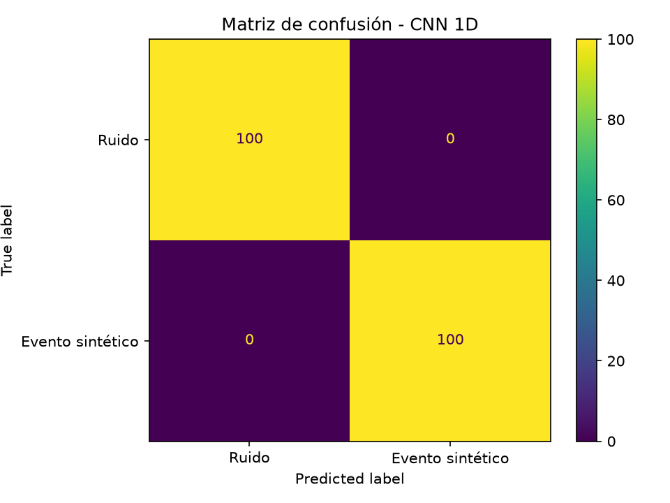

<<<<<<< HEAD
# 🌍 Proyecto XAI Sismología — CNN 1D con Inteligencia Artificial Explicable
=======
## Equipo 6

*   Addel Vidal García
*   Alejandro Colón Alvarez
*   Miguel Angel Banteurt Blanco


XAI aplicado a señales sísmicas
>>>>>>> 5c3dea47bcbbd7982ff1dcccd5d3a61b9b94e113

[](https://www.python.org/)
[](https://pytorch.org/)
[](LICENSE)
[]()

> **Equipo 6** | Inteligencia Artificial Avanzada | Universidad de las Ciencias Informáticas (UCI), Cuba

## 👥 Integrantes

- **Addel Vidal García**
- **Alejandro Colón Álvarez**
- **Miguel Ángel Banteurt Blanco**

## 📋 Descripción

Este proyecto implementa una **red neuronal convolucional unidimensional (CNN 1D)** para clasificar señales sísmicas en dos categorías: **ruido** y **evento sísmico**, combinada con técnicas de **Inteligencia Artificial Explicable (XAI)** para interpretar las decisiones del modelo.

El sistema fue validado tanto con datos sintéticos (generados mediante un modelo computacional basado en ondas sinusoidales amortiguadas) como con datos reales descargados de la red global FDSN (estación IU.ANMO).

##  Objetivos

### Objetivo General
Aplicar un método de XAI para interpretar las predicciones de un modelo de aprendizaje automático destinado a clasificar señales sísmicas.

### Objetivos Específicos
- Generar señales sintéticas basadas en un modelo computacional físicamente inspirado.
- Implementar y entrenar una CNN 1D desde cero usando PyTorch.
- Aplicar **Integrated Gradients** (vía Captum) para explicar las predicciones.
- Descargar y procesar datos sísmicos reales de la red FDSN.
- Comparar el rendimiento entre datos sintéticos y reales.
- Proporcionar un pipeline reproducible para futuras extensiones con datos del CENAIS.

## 🧠 ¿Por qué una CNN 1D?

Las señales sísmicas son **series temporales** que representan la evolución de la amplitud del suelo en el tiempo. Una CNN 1D es la arquitectura natural para este tipo de datos porque:

1. **Preserva la estructura temporal:** A diferencia de las CNN 2D (que requieren transformar la señal en espectrogramas), la CNN 1D opera directamente sobre la forma de onda, evitando pérdidas de información.
2. **Eficiencia computacional:** Requiere menos parámetros y es más rápida de entrenar que las arquitecturas 2D o basadas en Transformers.
3. **Interpretabilidad:** Las atribuciones de XAI sobre la señal cruda son más intuitivas para sismólogos.

Esta decisión se basa en trabajos recientes como:
- *"Seismic Signal Classification using One Dimension CNN and Transformer Encoder"* (IEEE, 2025)
- *"Design of 1D CNN Kernels for Predicting Seismic Response of Nuclear Power Plants"* (NC State, 2024)

**Nota:** El modelo fue implementado desde cero por el equipo. No se utilizó ninguna red preentrenada.

##  Generación de Datos Sintéticos

Los datos sintéticos se generaron mediante un **modelo computacional** inspirado en la física de las ondas sísmicas:

$$x(t) = A(t) \left[ \sin(2\pi f_1 t) + \alpha \sin(2\pi f_2 t) \right] + \epsilon(t)$$

Donde:
- $A(t) = A_0 e^{-\beta t}$ es una envolvente temporal que simula la atenuación de amplitud.
- $f_1 = 5$ Hz y $f_2 = 9$ Hz son frecuencias dominantes típicas de eventos sísmicos locales.
- $\alpha = 0.5$ es un factor de ponderación.
- $\epsilon(t) \sim \mathcal{N}(0, 0.25)$ representa el ruido de fondo.

Se generaron **1,000 señales** (500 ruido + 500 eventos) de 500 muestras cada una (5 segundos a 100 Hz), normalizadas individualmente al rango $[-1, 1]$.

## 🔬 Método de Explicabilidad: Integrated Gradients

Se seleccionó **Integrated Gradients (IG)** como método XAI por las siguientes razones:

1. **Fundamento axiomático:** Satisface los axiomas de completitud y sensibilidad [Sundararajan et al., 2017].
2. **Agnóstico al modelo:** Funciona con cualquier red diferenciable sin modificar su arquitectura.
3. **Interpretabilidad temporal:** Produce atribuciones por muestra, ideales para series temporales.
4. **Implementación madura:** Disponible en la biblioteca Captum para PyTorch.

El método calcula atribuciones integrando los gradientes a lo largo de una trayectoria desde una línea base (señal de ceros) hasta la entrada:

$$\text{IG}(x) = (x - x') \times \int_{\alpha=0}^{1} \frac{\partial F(x' + \alpha(x - x'))}{\partial x} d\alpha$$

En la práctica, la integral se aproxima con $n = 100$ pasos.

**Referencia principal:** Sundararajan, M., Taly, A., & Yan, Q. (2017). *Axiomatic Attribution for Deep Networks*. ICML 2017.

## 📈 Resultados

### Datos Sintéticos

| Métrica | Precisión | Exhaustividad | F1-Score | Soporte |
|---------|-----------|---------------|----------|---------|
| Ruido | 1.00 | 1.00 | 1.00 | 100 |
| Evento Sintético | 1.00 | 1.00 | 1.00 | 100 |
| **Exactitud** | | | **1.00** | 200 |

### Datos Reales (FDSN - IU.ANMO)

| Métrica | Precisión | Exhaustividad | F1-Score | Soporte |
|---------|-----------|---------------|----------|---------|
| Ruido Real | 0.88 | 0.87 | 0.87 | 100 |
| Evento Real | 0.87 | 0.88 | 0.88 | 100 |
| **Exactitud** | | | **0.875** | 200 |

La reducción del 12.5% al pasar de datos sintéticos a reales es esperada y documentada en la literatura, y justifica el uso de XAI para entender las limitaciones del modelo.

### Visualización XAI



*Figura: Atribuciones de Integrated Gradients sobre un evento sintético correctamente clasificado. Arriba: señal de entrada. Abajo: relevancia por muestra (rojo = contribución positiva a la clase "evento").*



*Figura: Matriz de confusión en el conjunto de prueba sintético.*

## 💡 Aportes y Aplicaciones

### Aportes Actuales
- Implementación completa de una CNN 1D para clasificación de señales sísmicas.
- Aplicación de Integrated Gradients para explicar predicciones en series temporales.
- Pipeline reproducible para descarga y procesamiento de datos FDSN.
- Base metodológica para futura validación con datos del CENAIS.

### Aplicaciones Futuras
- Sistema de detección automática de eventos sísmicos.
- Herramienta de apoyo para sismólogos en la revisión de catálogos.
- Estudio comparativo de métodos XAI en señales geofísicas.
- Integración con redes de monitoreo en tiempo real.

**⚠️ Nota:** Este prototipo no debe utilizarse como sistema operativo de alerta temprana ni como sustituto de los servicios sismológicos oficiales.

## 🚀 Instalación y Ejecución

### Requisitos
- Python 3.12+
- PowerShell (Windows) o Bash (Linux/Mac)

### Pasos

1. **Clonar el repositorio:**
```bash
   git clone https://github.com/[usuario]/Proyecto-XAI-Sismologia.git
   cd Proyecto-XAI-Sismologia
```

2. **Crear y activar el entorno virtual:**
```bash
   python -m venv .venv
   .\.venv\Scripts\Activate.ps1  # Windows
   source .venv/bin/activate     # Linux/Mac
```

3. **Instalar dependencias:**
```bash
   pip install -r requirements.txt
```

4. **Generar datos sintéticos:**
```bash
   python generar_datos.py
```

5. **Entrenar la CNN:**
```bash
   python entrenar_cnn.py
```

6. **Aplicar XAI:**
```bash
   python explicar_modelo.py
```

7. **Generar dataset real:**
```bash
   python preparar_dataset_real_final.py
```

8. **Entrenar con datos reales:**
```bash
   python entrenar_cnn.py  # (ya modificado para usar senales_reales.npy)
```

## 📁 Estructura del Proyecto
Proyecto XAI Sismologia/
├── README.md                              # Documentación en español
├── README_EN.md                           # Documentación en inglés
├── paper.tex                              # Pre-artículo en LaTeX
├── requirements.txt                       # Dependencias Python
├── .gitignore                             # Archivos ignorados por Git
├── generar_datos.py                       # Generador de datos sintéticos
├── entrenar_cnn.py                        # Entrenamiento de la CNN 1D
├── explicar_modelo.py                     # Aplicación de XAI (Integrated Gradients)
├── preparar_dataset_real.py               # Descarga y preparación de datos reales
├── preparar_datos_stead.py                # Preparación de datos STEAD (futuro)
├── descargar_senal_real.py                # Descarga de señal real desde FDSN
├── descargar_senal_evento.py              # Descarga de señal de evento específico
├── analizar_senal_real.py                 # Análisis y visualización de señal real
├── analizar_evento_real.py                # Análisis de evento sísmico real
├── consultar_catalogo.py                  # Consulta al catálogo USGS
├── comprobar_entorno.py                   # Verificación del entorno de desarrollo
├── inspeccionar_stead.py                  # Inspección de dataset STEAD
├── datos/                                 # Datos generados (no se suben a Git)
│   ├── senales.npy                        # Señales sintéticas (1000 x 500)
│   ├── senales_reales.npy                 # Señales reales (1000 x 500)
│   └── etiquetas.npy                      # Etiquetas de las señales
├── modelos/                               # Modelos entrenados
│   ├── cnn_sismica.pth                    # Modelo entrenado con datos sintéticos
│   └── cnn_sismica_REAL.pth               # Modelo entrenado con datos reales
├── resultados/                            # Gráficas y métricas
│   ├── matriz_confusion.png               # Matriz de confusión (datos sintéticos)
│   ├── matriz_confusion_real.png          # Matriz de confusión (datos reales)
│   ├── explicacion_integrated_gradients.png  # Visualización XAI
│   ├── dataset_real_ejemplos.png          # Ejemplos de dataset real
│   ├── y_real.npy                         # Etiquetas reales de prueba
│   ├── predicciones.npy                   # Predicciones del modelo
│   └── probabilidades.npy                 # Probabilidades del modelo
└── docs/                                  # Documentación adicional
└── informe_metodologico.md            # Informe metodológico detallado

##  Referencias

1. Sundararajan, M., Taly, A., & Yan, Q. (2017). *Axiomatic Attribution for Deep Networks*. ICML 2017.
2. Mousavi, S.M. et al. (2019). *STEAD: A Global Data Set of Seismic Signals for AI*. IEEE Access.
3. IEEE (2024). *Various Signal Transformation for Optimizing CNN Model Performance of Earthquake Detection*.
4. IEEE (2025). *Seismic Signal Classification using One Dimension CNN and Transformer Encoder*.
5. ScienceDirect (2025). *Enhancing seismic signal quality assessment with CNNs: A focus on effective data augmentation techniques*.
6. Captum Documentation: https://captum.ai/
7. ObsPy Documentation: https://docs.obspy.org/
8. USGS Earthquake Catalog: https://earthquake.usgs.gov/

## 📄 Licencia

Este proyecto está bajo la licencia MIT. Ver archivo `LICENSE` para más detalles.

## 🙏 Agradecimientos

- Centro Nacional de Investigaciones Sismológicas (CENAIS), Cuba.
- Servicio Geológico de los Estados Unidos (USGS).
- Red FDSN (Federated Digital Seismograph Networks).